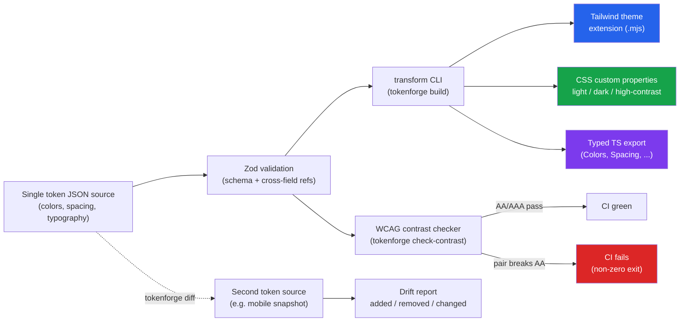

# tokenforge

**One design-token source of truth, forged into Tailwind, CSS, and TypeScript -- with a WCAG contrast gate that fails your CI before a bad pair ships.**

[](https://github.com/itzzshut/tokenforge/actions/workflows/ci.yml)


## Why

Color, spacing and typography values often live in several places at once: a Figma library, a global stylesheet, a `tailwind.config.js`, a mobile token JSON, native constants. Each copy can drift from the others, and a rebrand or dark-mode rollout means finding every copy by hand.

tokenforge makes one JSON file the only thing a person edits. Tailwind's theme, CSS custom properties for light, dark and high-contrast modes, and a typed TypeScript module are generated from it. Two CLI commands cover the failure cases: `check-contrast` fails when a declared color pair drops below its WCAG level, and `diff` reports value differences between two token documents.

## Features

- Single JSON token source (colors with light/dark/high-contrast values, spacing, typography, contrast pairs), validated with Zod including cross-field reference checks.
- Three generated outputs: a Tailwind theme extension, CSS custom properties for all three modes, and a typed TypeScript module.
- WCAG 2.x contrast checker for every declared foreground/background pair in every applicable mode, with a non-zero exit code on failure.
- Drift detector that reports added, removed and changed values between two token documents.
- Runs fully offline; one runtime dependency (`zod`).

## Architecture



`tokens.json` is validated by a [Zod](https://zod.dev) schema, plus a cross-field check that every `contrastPairs` entry references an existing color. The three transforms then run on the same parsed document:

1. **Tailwind theme extension**: every color resolves to `var(--tf-color-*)`.
2. **CSS custom properties**: scoped to `:root`/`[data-theme='light']`, `@media (prefers-color-scheme: dark)` plus `[data-theme='dark']`, and `[data-contrast='high']`.
3. **Typed TypeScript module**: `as const` objects, derived union types and a `resolveColor(token, mode)` helper.

`check-contrast` computes WCAG 2.x contrast ratios (relative-luminance formula) for each declared pair in each applicable mode and exits non-zero if any pair misses its level. `diff` compares two token documents and lists added, removed and changed values.

## Design notes

- **Tailwind colors resolve to `var(--tf-color-*)`, not literal hex values.** The Tailwind config is generated once; switching `data-theme` or `data-contrast` on an element changes the CSS variables and every utility class follows, with no rebuild. The trade-off is that Tailwind's opacity modifiers (such as `bg-primary/50`) can't be derived from a variable that holds an arbitrary color string.
- **Missing modes fall back to light.** `dark` and `highContrast` are optional per color. The CSS output only declares a variable in the dark or high-contrast block when that mode is set, so other colors inherit the `:root` light value. The contrast checker applies the same fallback, so it evaluates the values a browser would actually render.
- **Contrast is checked on the source, not on rendered output.** Pairs are declared explicitly in `contrastPairs`, so only listed combinations are tested. Unlisted foreground/background combinations are not.
- **No network integrations.** There is no Figma or native-platform sync. Those need auth and have rate limits; leaving them out keeps every command deterministic and runnable offline or in CI. The input format is plain JSON, so an adapter can convert from another tool's export.

## Quick start

```bash
npm install
npm run build      # compiles TypeScript -> dist/
npm test           # runs the Vitest suite (104 tests)

# Validate + transform the bundled example token set
npm run cli -- build --input examples/tokens.json --out-dir examples/output

# Run the WCAG AA gate against the same source (exits 1 on any failing pair)
npm run cli -- check-contrast --input examples/tokens.json

# Detect drift between the source and a (deliberately stale) mobile snapshot
npm run cli -- diff --a examples/tokens.json --b examples/tokens-mobile-drifted.json
```

Or, once built, run the packaged bin directly:

```bash
node bin/tokenforge.mjs check-contrast --input examples/tokens.json
```

### Docker

```bash
docker build -t tokenforge .
docker run --rm tokenforge help
```

The image's build stage runs `npm run build && npm test`, so a Docker build fails the same way CI does if the transforms or contrast logic regress.

### Example output

```text
$ npm run cli -- check-contrast --input examples/tokens.json
[PASS] body-text-on-background (light, AA): foreground on background = 17.85:1 (needs 4.5:1)
[PASS] primary-button (light, AA): primaryForeground on primary = 5.17:1 (needs 4.5:1)
...

$ npm run cli -- diff --a examples/tokens.json --b examples/tokens-mobile-drifted.json
3 drift entries detected:
  ~ colors.primary.light: #2563eb -> #1d4ed8
  + colors.warning = #f59e0b
  - spacing.2xl (was 48px)
```

## CLI reference

```
tokenforge build --input <tokens.json> --out-dir <dir>
tokenforge check-contrast --input <tokens.json>
tokenforge diff --a <tokens-a.json> --b <tokens-b.json> [--fail-on-drift true]
```

| Command | What it does | CI use |
|---|---|---|
| `build` | Validates the source, writes `tailwind.theme.mjs`, `variables.css`, `tokens.ts` | Run on every commit; commit the outputs or publish them as build artifacts |
| `check-contrast` | Computes WCAG contrast ratios for every declared pair, across modes | Exits 1 if any pair fails its level; usable as a required PR check |
| `diff` | Reports added/removed/changed values between two token documents | Compare the source with a per-surface snapshot; exits 1 on drift only with `--fail-on-drift` |

## Token schema (excerpt)

```json
{
  "name": "acme-design-system",
  "version": "1.0.0",
  "colors": {
    "primary": { "light": "#2563eb", "dark": "#60a5fa", "highContrast": "#1d4ed8" }
  },
  "spacing": { "md": "16px" },
  "typography": {
    "fontFamilies": { "sans": "Inter, system-ui, sans-serif" },
    "fontSizes": { "base": "16px" },
    "fontWeights": { "regular": 400 },
    "lineHeights": { "normal": 1.5 }
  },
  "contrastPairs": [
    { "name": "primary-button", "foreground": "primaryForeground", "background": "primary", "level": "AA" }
  ]
}
```

`dark` and `highContrast` are optional per color; when omitted, the transforms and the contrast checker use the `light` value.

## Testing

```bash
npm test            # Vitest: schema, contrast math, diff, all three transforms, CLI
npm run typecheck   # tsc --noEmit
```

CI runs type check, build, tests, an example build and the contrast gate on Node 18 and 20.

## Project layout

```
src/
  schema.ts              Zod schema + parseDesignTokens()
  contrast.ts             WCAG relative-luminance / contrast-ratio math + AA/AAA gate
  diff.ts                 Token drift detector
  cli.ts                  Argument parsing + the three subcommands
  transforms/
    tailwind.ts            -> Tailwind theme.extend fragment
    css.ts                 -> CSS custom properties (light/dark/high-contrast)
    typescript.ts          -> typed TS module
tests/                    Vitest unit tests (schema, contrast, diff, transforms, CLI)
examples/
  tokens.json              Example source (checked in)
  tokens-mobile-drifted.json  Deliberately stale snapshot, for the diff demo
  output/                  Generated Tailwind/CSS/TS + a sample drift report (checked in, proves round-trip fidelity)
```

## Limitations and non-goals

- **No Figma or native sync.** The tool reads and writes local files only. Importing from Figma, Style Dictionary or a mobile app means converting to this JSON format first.
- **No alias or reference tokens.** A color token is a literal value; one token cannot point at another. The schema accepts `var(--...)` strings as colors, but they are treated as plain text, and `check-contrast` throws on them.
- **Only colors have modes.** `dark` and `highContrast` exist on color tokens only. Spacing and typography have a single value.
- **Contrast math supports hex and `rgb()`/`rgba()` only.** `hsl()`, `transparent` and `currentColor` pass schema validation but cause `check-contrast` to fail with a parse error. Alpha is ignored.
- **`diff` compares values by path.** A renamed token appears as one removed and one added entry. It covers colors, spacing, font families, sizes, weights and line heights; it does not compare `letterSpacings` or `contrastPairs`.
- **Minimal argument parsing.** Flags must be written `--name value` (`--name=value` is not supported). A flag with no following value, or followed by another `--flag`, is set to `"true"`. `--fail-on-drift` only fails the run when its value is exactly `true`, so `--fail-on-drift false` or `--fail-on-drift yes` does not.

## License

MIT, see [LICENSE](LICENSE).

## Maintainer

Originally published as [itzzshut/tokenforge](https://github.com/itzzshut/tokenforge), tokenforge is currently maintained by **Mariam Malik**, a Software Engineer and Full-Stack Developer with 1+ years of professional experience.

Email: [mariammalik5100@gmail.com](mailto:mariammalik5100@gmail.com)